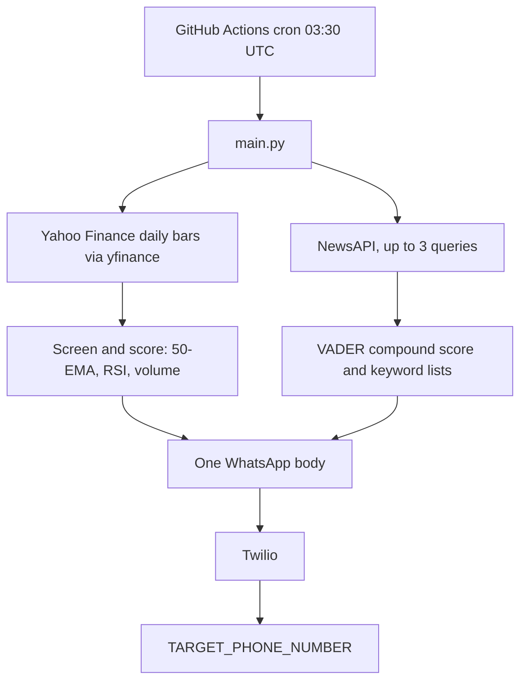

# Stock Pulse

A personal daily WhatsApp brief for a fixed list of Indian large-caps. Each scheduled run screens 50 NSE symbols, attaches recent headlines with a simple sentiment score, and sends one message to one phone number.

This is a single-user script plus a GitHub Actions schedule. It is not a web app, not a multi-user product, and not live pre-market data.

Built by Sachin Gautam.

## Problem

Stock Pulse puts a fixed large-cap screen and a short set of headlines into one WhatsApp message, aimed at the time before the NSE cash open at 9:15 IST. The code does not record how long that morning check used to take.

The repository does not record interviews, a waitlist, or whether the message was read. The only recipient the code knows about is the phone number in `TARGET_PHONE_NUMBER`.

## Target user

**Today:** one person, the owner of that phone number. There is no signup, account, or second recipient.

**Not in this repo:** other retail traders. The default sender is Twilio's public WhatsApp sandbox number (`whatsapp:+14155238886`), which is a developer tool. Someone has to join that sandbox from the recipient phone before messages arrive.

## What it does

The workflow is scheduled for **09:00 IST** with the cron `30 3 * * *` (03:30 UTC). India has no daylight-saving time, so that conversion does not move during the year. GitHub starts scheduled jobs when a runner is free, so the run often begins later than 09:00. See [Operating history](#operating-history).

`python main.py` and `python main.py --run` do the same job:

1. **Screen 50 NSE symbols** hardcoded in `config.py` (`DEFAULT_TICKERS`). They are not loaded from Nifty 50 or Nifty 500 membership. `NIFTY_500_TICKERS_FILE` names `nifty500_tickers.csv`, but nothing reads that path and the file is not in the repo.
2. For each symbol, download about three months of **daily** OHLCV from Yahoo Finance with `yfinance` (`period='3mo'`), one symbol at a time. A symbol is dropped when the download is empty or has fewer than 70 rows (`EMA_PERIOD + 20`), or when the latest close is under ₹50.
3. On the rows that remain, compute:
   - a 50-day EMA (`pandas` `ewm`, span 50, `adjust=False`)
   - a 14-period RSI from a simple rolling mean of gains and losses (not Wilder smoothing)
   - the latest volume divided by the mean of the last 20 volume bars
   - the percent change from the previous daily close to the latest close
4. **Keep a name only when the close is above the 50-EMA and at least one of these is also true:** RSI is strictly between 50 and 70, or volume is strictly above 1.5× the 20-day average. All three conditions do not have to pass.
5. **Score 0–100:** above the EMA +30, RSI in that band +25, volume above 1.5× +25, daily change strictly above 2% +20. The label is `BREAKOUT` when the score is at least 70, otherwise `MOMENTUM`. Return at most 10 names, highest score first.
6. **Fetch news** from NewsAPI for the last 1 day (the date is computed in Asia/Kolkata): an India market query and a global macro query, 20 articles each. If any names passed the screen, a third query covers the top 5 symbols, up to 30 articles.
7. Score each title plus description with **VADER** (a rule-based lexicon, compound score from -1 to +1). Keep a high-impact item when the text contains a keyword from `HIGH_IMPACT_KEYWORDS` and the absolute score is above 0.3 (first 5 matches, in article order, not a re-rank). Keep a macro item when it contains a `MACRO_KEYWORDS` hit and the absolute score is above 0.2 (first 3). A stock mention is a case-insensitive substring of the symbol, not a whole word.
8. **Send one WhatsApp message** through Twilio. If the pipeline throws, the script tries a short error message and then exits non-zero. If Twilio does not accept the report, the process exits non-zero as well.

`python main.py --test` checks that the four required environment variables are set, screens the first 5 symbols, calls NewsAPI, and sends a real WhatsApp test message. It exits non-zero if any step fails.

## Architecture



## Product decisions and trade-offs

These are visible in the code and in the Actions history. They are descriptions of what shipped, not a claim about a research process.

| Decision | What shipped | Trade-off |
| --- | --- | --- |
| WhatsApp via Twilio | One message to one number. The sender defaults to Twilio's public sandbox number. | The sandbox is for development. There is no way to add a user from this repo. |
| 50 hardcoded large-caps | A fixed list, so the job stays small and avoids thin names. | Mid-caps and a personal watchlist are out. The unused Nifty 500 path suggests a wider universe was considered and not built. |
| Daily Yahoo Finance bars on a 09:00 IST cron | No paid market-data vendor and no server. | This is not a pre-open quote. The latest daily bar is the last completed session Yahoo returns. The message title still says `PRE-MARKET`. |
| Run every day | One cron expression, including weekends and NSE holidays. | The phone gets a brief when the market is closed. |
| Pass rule is EMA and (RSI or volume) | More names can qualify than if all three filters were required. | An older README described the stricter rule. The code does not implement it. |
| A 0–100 score and two labels | Easy to scan in a chat message. `BREAKOUT` means the score is at least 70. | It is not an EMA crossover detector, and the points are not calibrated to later returns. |
| VADER plus keyword lists | No model API, and the tags are easy to explain. | VADER is a general lexicon, not a finance model. The footer still says `Powered by Stock Pulse AI`. Short symbols such as `LT` match inside other words (`LT` is inside `RESULTS`). |
| GitHub Actions instead of a server | No host to pay for. The schedule ran every day from 2 January through 5 November 2026. | The job depends on the runner image. It broke on 6 November 2026 when `ubuntu-latest` no longer had Python 3.9. GitHub also starts the cron late. |

## Example message

There is no screenshot in the repo. The block below is **an example of the layout**, produced by calling `WhatsAppBot.format_stock_report` with made-up prices, scores, and headlines. It was not captured from a phone, and it is not a record of a live run. The figures do follow the scoring rules: 100 is all four point awards, and 55 is EMA plus the RSI band only. Headlines are sliced to 100 characters (80 for a stock mention) and the code always appends `...`.

On 1 September, 1 October, and 5 November 2026 the real message took the empty-screen path (`No strong breakouts detected today.`) because Yahoo Finance returned no prices. See [Limitations](#limitations).

```text
🚀 *PRE-MARKET STOCK PULSE*
📅 25 Nov 2026, 09:00 AM IST
===================================

📈 *TOP TECHNICAL BREAKOUTS*

🔥 *RELIANCE*
   Price: ₹1000.0 (🟢 +2.40%)
   RSI: 64.2 | Vol: 1.8x
   Signal: BREAKOUT (Score: 100/100)

⚡ *TCS*
   Price: ₹500.0 (🟢 +0.80%)
   RSI: 58.1 | Vol: 1.2x
   Signal: MOMENTUM (Score: 55/100)

🌍 *MACRO EVENTS*

🟢 Example headline about the RBI holding its policy rate...
   Keywords: rbi, policy

💥 *HIGH-IMPACT NEWS*

🟢 Example headline about a contract win...
   Tags: contract

📰 *STOCK IN NEWS*

• *RELIANCE*: 1 mention(s)
  🟢 Example headline that mentions Reliance...

===================================
⚠️ *DISCLAIMER*: This is automated analysis.
Not financial advice. DYOR before trading.

🤖 Powered by Stock Pulse AI
```

Prices use Python's default formatting, so one thousand prints as `₹1000.0`.

## Operating history

Checked against the GitHub Actions API on 25 November 2026. The full list is on the [Actions tab](https://github.com/sachinG549/stock-pulse/actions).

- The API lists **328 scheduled runs**, numbered **#18 through #345**, one per calendar day from **2 January 2026 through 25 November 2026**, with no missing day and no duplicate day in that span. Runs **#1–#17** are not in the listing. No `workflow_dispatch` run has been recorded. The workflow file was added on 17 December 2025.
- **308 runs succeeded**, from 2 January through **5 November 2026**. **20 runs failed**, from **6 November through 25 November 2026**. The scheduled job did run every day through most of 2026. "Succeeded" means the process exited 0.
- The cron is 03:30 UTC, but the runs started later. Across all 328 runs the **median start was 166 minutes after 03:30 UTC**. The median delay was 60 minutes in January 2026, 381 minutes in October, and 481 minutes in November. A January run often began around 10:00 IST. By November, runs were often starting in the evening IST. The schedule says 09:00. The history does not.
- Where a successful run's last-update time is still within 30 minutes of its start (234 runs), the gap from start to update was **62 to 126 seconds, median 80 seconds**, including dependency install. On 5 November the script step itself lasted about 30 seconds.
- A green run was not, by itself, proof of delivery: until this branch, a failed Twilio send still exited 0. The logs opened for **1 September, 1 October, and 5 November 2026** each show Twilio accepting the message (HTTP 201). The other success logs were not opened. The 15 August 2026 log is no longer retained (HTTP 410).
- Those same three logs show **zero names screened**. Yahoo Finance returned an error for all 50 symbols (`Expecting value: line 1 column 1`). Each run still fetched 40 headlines (5 tagged high-impact, 3 tagged macro, 0 stock mentions) and sent the empty-screen message.
- The **6 November and 25 November 2026** logs both fail in `actions/setup-python` with: `The version '3.9' with architecture 'x64' was not found for Ubuntu 26.04.` The workflow file on `main` had not changed. Those logs also warn that `actions/checkout@v3` and `actions/setup-python@v4` target Node.js 20. This branch uses Python 3.12, `actions/checkout@v7`, and `actions/setup-python@v7`.

As of 25 November 2026 the public repo had the description "Daily stock market alerts", no topics, 0 stars, 0 forks, and no issues or pull requests. GitHub does not render `readme.txt`, which is why this file is `README.md`.

## Tech stack

- Python 3.12 in GitHub Actions. The pins in `requirements.txt` (including `numpy==1.26.2` and `pandas==2.1.4`) support 3.12 and not 3.13.
- [yfinance](https://github.com/ranaroussi/yfinance) `0.2.33` for daily OHLCV
- pandas and numpy for the EMA, RSI, and volume math
- [NewsAPI](https://newsapi.org/) (`newsapi-python==0.2.7`) for headlines
- [VADER](https://github.com/cjhutto/vaderSentiment) `3.3.2` for the sentiment score
- [Twilio](https://www.twilio.com/) `8.11.1` for WhatsApp
- `python-dotenv` for a local `.env` file
- GitHub Actions for the schedule

`requirements.txt` is already a fully pinned freeze, including transitive packages. This branch does not loosen it.

## Setup

```bash
git clone https://github.com/sachinG549/stock-pulse.git
cd stock-pulse
python3 -m venv .venv
source .venv/bin/activate
pip install -r requirements.txt
cp .env.example .env
```

Fill these in `.env`. The same names are repository secrets for Actions.

| Variable | Required | Role |
| --- | --- | --- |
| `NEWSAPI_KEY` | Yes | NewsAPI |
| `TWILIO_ACCOUNT_SID` | Yes | Twilio |
| `TWILIO_AUTH_TOKEN` | Yes | Twilio |
| `TARGET_PHONE_NUMBER` | Yes | One recipient, `whatsapp:+` and E.164 digits |
| `TWILIO_WHATSAPP_FROM` | No | Sender. Blank uses `whatsapp:+14155238886` |

Join the WhatsApp sandbox from the recipient phone (Twilio Console → Messaging → WhatsApp sandbox) before expecting a message.

```bash
python main.py --test   # contacts NewsAPI and sends a real test message
python main.py --run    # the daily job
```

For Actions, set the secrets above on the repository, merge to `main`, and either wait for the cron or use **Run workflow**. The schedule runs from the default branch only. `TWILIO_WHATSAPP_FROM` may be stored as a secret; an empty value keeps the sandbox sender.

A NewsAPI key was previously committed inside a debug `print` in `config.py`. That line is gone from the current file. **The key is still in git history, so it has to be revoked and replaced.** Do not commit a new key.

## Configuration

Knobs in `config.py`:

| Name | Value | Effect |
| --- | --- | --- |
| `EMA_PERIOD` | 50 | EMA length, and part of the 70-row minimum |
| `RSI_LOWER_BOUND` / `RSI_UPPER_BOUND` | 50 / 70 | Keep RSI only when `50 < RSI < 70` |
| `VOLUME_MULTIPLIER` | 1.5 | Keep the volume flag only when the ratio is **greater than** 1.5 |
| `MIN_PRICE` | 50 | Drop a latest close below ₹50 |
| `MAX_STOCKS_TO_REPORT` | 10 | Cap the message |
| `NEWS_LOOKBACK_DAYS` | 1 | NewsAPI `from` date |
| `HIGH_IMPACT_KEYWORDS`, `MACRO_KEYWORDS` | lists in `config.py` | Substring tags, lowercased |

Editing `DEFAULT_TICKERS` is how the universe changes. There is no CSV loader.

## Limitations

- **Prices are not coming back with the pinned client.** On 25 November 2026, `yfinance==0.2.33` returned no rows for `RELIANCE.NS` and raised `Expecting value: line 1 column 1`, the same error as the September, October, and 5 November Actions logs. The screen in those logs was empty. Upgrading the library is a product fix, not a cosmetic one, and it is not in this branch.
- **Three months of bars is shorter than the screen's minimum.** The same day, `yfinance` 1.8.0 (not the version this repo installs) returned **62** daily rows for a 3-month window on `RELIANCE.NS`, `TCS.NS`, and `ITC.NS`, and **126** rows for 6 months. The code drops a series shorter than **70** rows. A newer library, without a longer window, would still drop those names.
- The message can say `PRE-MARKET` and `Stock Pulse AI` while the inputs are the previous daily bar and a lexicon.
- News matching is a substring. `LT`, `ITC`, and `TCS` will hit unrelated headlines.
- High-impact and macro lists are the first matches in fetch order, capped at 5 and 3. They are not sorted by score.
- The job runs on weekends and NSE holidays.
- One Twilio sandbox recipient. No analytics, no "was this useful?" response, and no record of opens.
- GitHub does not start the cron at 09:00 IST. See the delays above.
- There is no web UI, database, holiday calendar, deployment guide, AWS Lambda config, or Render config in this repo.

## Possible next steps

Not a commitment. Reasonable follow-ons from the limits above:

- Revoke the NewsAPI key that remains in git history, and confirm a manual Actions run actually reaches the phone.
- Move off `yfinance==0.2.33`, and request enough daily history that the 70-row check can pass (6 months was 126 rows on 25 November 2026).
- Skip weekends and NSE holidays.
- Match tickers on word boundaries, and change the message footer and title so they match the data.
- Add a redacted screenshot of a real message.
- Only after a second person is actually receiving it: a channel other people can join, and a count of whether the brief was useful. Those numbers are not in the repo today.

## Disclaimer

This is an educational, personal project. It is not financial advice, not a registered advisory service, and not a forecast. Past signals do not predict prices. Do your own research.

## License

[MIT](LICENSE). Copyright (c) 2025 Sachin Gautam.
